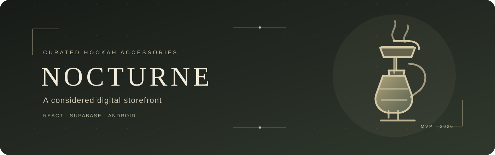

<div align="center">



# NOCTURNE · Hookah Store MVP

**Современный каталог кальянных аксессуаров с авторизацией, админ-панелью и Android-приложением.**

[Открыть сайт](https://nocturne-hookah-mvp.pages.dev) · [Исходный код](https://github.com/TheEliteLions/hookah-shop-miniapp) · [Сводка проекта](docs/teacher-summary.md)

[](https://github.com/TheEliteLions/hookah-shop-miniapp/actions/workflows/ci.yml)
[](https://github.com/TheEliteLions/hookah-shop-miniapp/actions/workflows/database-tests.yml)
[](https://github.com/TheEliteLions/hookah-shop-miniapp/actions/workflows/android-apk.yml)

</div>

## О проекте

NOCTURNE — готовый MVP русскоязычного адаптивного каталога кальянных аксессуаров. В проекте соединены веб-интерфейс, облачная база данных, регистрация пользователей, защищённые инструменты управления товарами и Android-приложение на базе WebView.

**Демо:** [nocturne-hookah-mvp.pages.dev](https://nocturne-hookah-mvp.pages.dev) · **Репозиторий:** [TheEliteLions/hookah-shop-miniapp](https://github.com/TheEliteLions/hookah-shop-miniapp)

## Возможности

- Каталог товаров с поиском, категориями, сортировкой и фотографиями из Supabase Storage.
- Корзина с количеством товаров и автоматическим расчётом суммы.
- Регистрация и вход по e-mail и паролю, выход из аккаунта и сохранение пользовательской сессии.
- Административное управление товарами: создание, редактирование, публикация и загрузка изображений.
- Разграничение доступа по ролям: администраторские права назначаются отдельно от публичной регистрации.
- Адаптивный интерфейс для настольных компьютеров и мобильных экранов.
- Android-приложение с фирменной иконкой и WebView для опубликованного сайта.
- Демонстрационный сценарий оформления заказа для показа пользовательского пути.

## Технологии

| Область | Инструменты |
| --- | --- |
| Frontend | React 19, TypeScript, Vite, CSS |
| Backend | Supabase Auth, PostgreSQL, Row Level Security, Storage |
| Android | Kotlin, Android WebView |
| Качество | ESLint, TypeScript, pgTAP, GitHub Actions |
| Публикация | Cloudflare Pages, GitHub Actions artifacts |

## Безопасность и тестирование

Доступ к данным каталога контролируется PostgreSQL RLS. Публичным посетителям доступны опубликованные товары, а изменение каталога и запись фотографий ограничены ролью администратора. Администраторская роль не выдаётся через форму регистрации. SQL-набор pgTAP проверяет политики доступа; последний зафиксированный запуск database workflow проверил 23 утверждения.

В frontend используются только публичные параметры Supabase: URL проекта и publishable key. Секреты и пароли базы не нужны браузеру и не должны включаться в клиентскую сборку.

## Запуск локально

Нужны Node.js 20.19+ или 22.12+ и npm.

```sh
npm ci
```

Скопируйте `.env.example` в `.env.local` и заполните локальные параметры:

```dotenv
VITE_SUPABASE_URL=https://<project-ref>.supabase.co
VITE_SUPABASE_PUBLISHABLE_KEY=<publishable-key>
VITE_SITE_URL=http://localhost:5173
VITE_PUBLIC_SIGNUP_ENABLED=true
```

Затем запустите приложение:

```sh
npm run dev
```

Команды качества и production-сборки:

```sh
npm run lint
npm run typecheck
npm run build
```

Локальные переменные хранятся в `.env.local`, который исключён из Git. Никогда не помещайте в frontend `service_role`, `sb_secret_...`, пароль базы данных или signing key.

## Публикация и дополнительные материалы

- [План развития](ROADMAP.md)
- [Инструкция по развёртыванию](docs/deployment.md)
- [Архитектура](docs/architecture.md)
- [Настройка администратора](docs/admin-bootstrap.md)
- [Уведомление о конфиденциальности](https://nocturne-hookah-mvp.pages.dev/privacy.html)
- [Сводка для преподавателя](docs/teacher-summary.md)

GitHub Actions автоматически проверяет frontend, SQL-доступ и собирает Android debug APK. Артефакт APK доступен в успешных запусках [Android workflow](https://github.com/TheEliteLions/hookah-shop-miniapp/actions/workflows/android-apk.yml).

Корзина и checkout предназначены для демонстрации MVP-сценария; приложение не принимает оплату и не создаёт реальные заказы.
